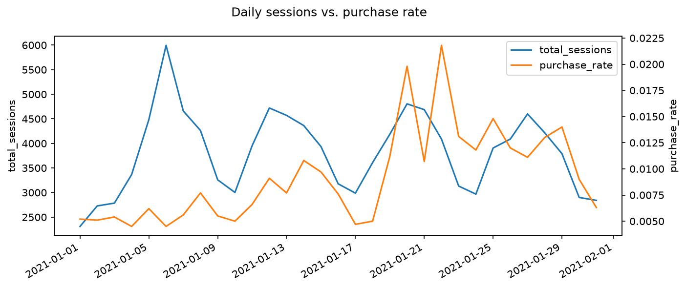
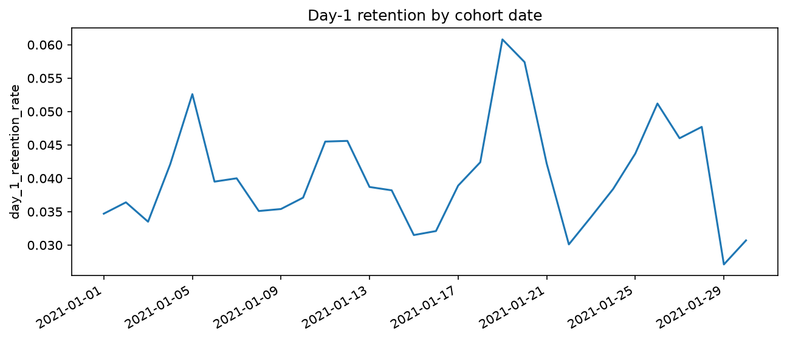
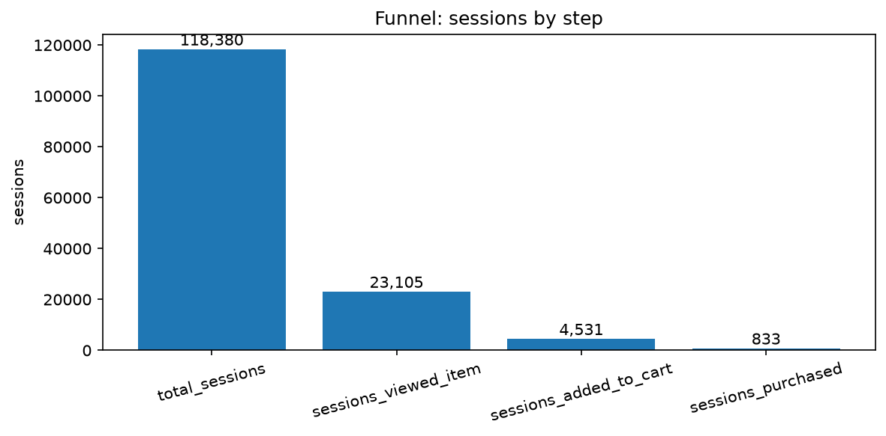

# GA4 Ecommerce Analysis: Retention, Sessions & Purchase Funnel

**Stack:** dbt (BigQuery) for transformation, Python/Jupyter for analysis and interpretation.
**Data:** [BigQuery public GA4 ecommerce sample dataset](https://console.cloud.google.com/marketplace/product/bigquery-public-data/ga4-ecommerce-sample), Jan 2021.
**Repo:** https://github.com/maresovaeva/dbt-learning-project

## The question

Does the GA4 ecommerce sample data show meaningful day-1 retention drop-off, and where in the purchase funnel does the biggest loss happen — a single bottleneck, or something more distributed?

## The approach

Built a small dbt pipeline: staging (`stg_events`, incremental, unnested from raw GA4 events) → intermediate (`int_sessions`, one row per session) → marts (`fct_sessions_daily`, `fct_user_retention`, `fct_funnel_purchase`). Each mart is documented and tested (`not_null`, `unique`, plus a custom monotonicity test — see below). Analysis and interpretation happened in a companion notebook (`analyses/retention_analysis.ipynb`), pulling from the marts rather than re-deriving logic in Python.

## Findings

**Sessions follow a strong weekly pattern.** Wednesday averages ~4,990 sessions vs. Sunday's ~2,920, a ~40% swing between the highest and lowest days.

Total sessions and purchase rate also spike together around Jan 20-23. Purchase rate rose with volume rather than diverging from it, consistent with a traffic event (promo or campaign) rather than a shift in demand quality.

**Day-1 retention is low and flat.** It hovers in the 3-6% range across the month with no clear upward or downward trend.

**The purchase funnel has no single bottleneck — it has three.**

| Step | Sessions | % of previous step |
|---|---|---|
| Total sessions | 118,380 | — |
| Viewed an item | 23,105 | 19.5% |
| Added to cart | 4,531 | 19.6% |
| Purchased | 833 | 18.4% |

All three step-to-step drop-offs cluster tightly around 80-82%. A single dominant bottleneck would point to one clear fix — an acquisition or landing-page problem. A flat ~80% attrition rate at every stage instead points to broad low-intent traffic, or independent friction worth investigating at each step separately.

## Data quality & rigor

Two real bugs were found and fixed during this analysis, both caught by cross-validating one mart's output against another rather than trusting either in isolation:

- **`fct_sessions_daily` and `fct_funnel_purchase` both undercounted sessions**, using `count(distinct session_id)`. GA4's `session_id` isn't globally unique across users — two different users can share a value, which `count(distinct session_id)` silently collapses. Each source CTE was already unique per `(user_pseudo_id, session_id)`, so the fix was `count(*)`. Caught when `fct_funnel_purchase`'s `total_sessions` (118,380) didn't match `fct_sessions_daily`'s sum (116,025), a ~2% gap that turned out to be real.
- **`fct_user_retention` showed an artificial cliff to 0% retention** for the most recent cohort dates. Those cohorts' "day+1" hadn't happened yet within the dataset's date range, so the denominator was real but the numerator structurally couldn't be. Fixed by excluding cohorts whose day-1 window isn't fully observed.

One assumption was checked rather than left implicit: the funnel model counts event *presence* per session, not strict order (a cart-add could in principle be counted even if it preceded the item view). Verified this affects only 0.26% of relevant sessions (12 of 4,531) — negligible, but documented in the model rather than assumed away.

A custom dbt test (`assert_funnel_monotonic`) now guards against the count-undercounting bug recurring — it fails if `total_sessions < sessions_viewed_item` or any later step exceeds an earlier one, which a plain `not_null` test would not have caught.

## What I'd do next

- **Segment the funnel and the Jan 20-23 spike by acquisition channel**, if channel data were available — a uniform ~80% attrition rate across all channels would support the "broad low-intent traffic" theory; concentration in one channel would point to a specific fix (e.g. a paid channel driving volume without intent).
- **Check whether day-1 retention varies by cohort size** — do the largest cohorts (likely acquired via the Jan 20-23 spike) retain worse than smaller, steadier cohorts?
- **Extend the incremental logic pattern from `fct_sessions_daily` back to `stg_events`** — the latter's incremental filter anchors on `current_timestamp()` rather than the data's own max date, which is more fragile for historical/backfill data.
